<a href="https://app-sahl-dev-sdc-vmi3r3.azurewebsites.net">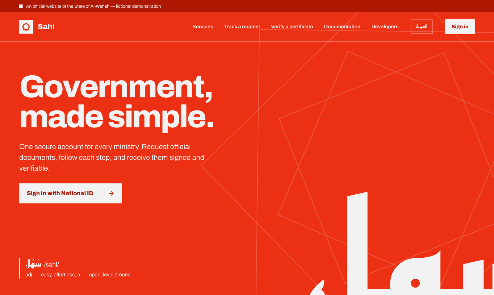</a>

<div align="center">

# Sahl &nbsp;·&nbsp; سهل

**Government, made simple. &nbsp;·&nbsp; الحكومة، ببساطة.**

A GCC-style government e-services portal for the fictional *State of Al-Wahah*,<br>
built end to end on Azure as a system-architecture portfolio project.

[](https://github.com/abuel3ees/sahl/actions/workflows/deploy.yml)


[**Live demo**](https://app-sahl-dev-sdc-vmi3r3.azurewebsites.net) &nbsp;·&nbsp;
[V1 documentation](docs/v1/ministry-of-interior.md) &nbsp;·&nbsp;
[API (OpenAPI)](docs/api/openapi.json) &nbsp;·&nbsp;
[Setup guides](docs/setup/) &nbsp;·&nbsp;
[Work journal](docs/journal/README.md)

</div>

> [!NOTE]
> **Everything here is fictional.** The State of Al-Wahah, its ministries, people and certificates are made up. No real government names, logos or systems are used. Certificates carry a *نموذج تجريبي* ("demo sample") watermark.

<br>

## What it does

**V1 is deliberately small:** one ministry, the Ministry of Interior, and one service, the Good Conduct Certificate. It's built properly, from the citizen's request to a certificate anyone can verify.

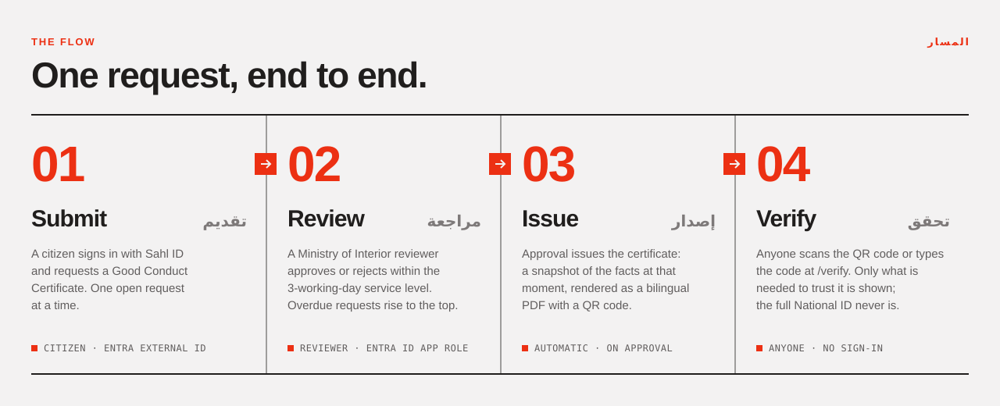

<br>

## Screens

Every screen is bilingual: **Arabic by default, right to left**, and English with a single toggle. The design system is *Modernist*:
- **typefaces:** Archivo, IBM Plex Sans Arabic, and Reem Kufi for display
- **colour:** one red, `#ec3013`
- **lines and corners:** 2 px rules, no rounded corners

<table>
  <tr>
    <td width="50%" valign="top">
      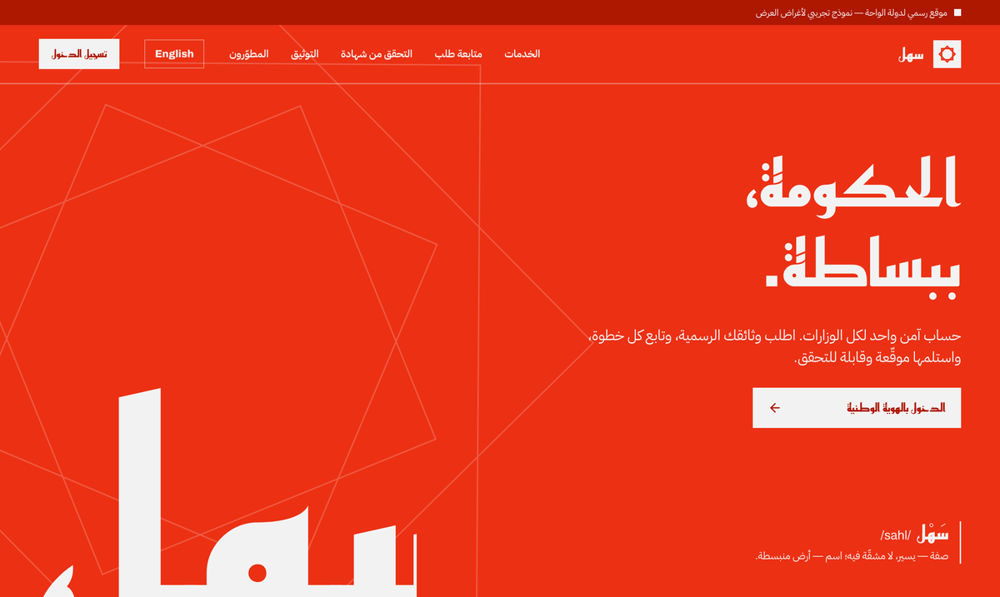
      <p><b>Arabic first.</b> The same landing page in its default language. The layout mirrors with logical CSS (<code>ms-</code>, <code>pe-</code>, <code>start-</code>), never left and right.</p>
    </td>
    <td width="50%" valign="top">
      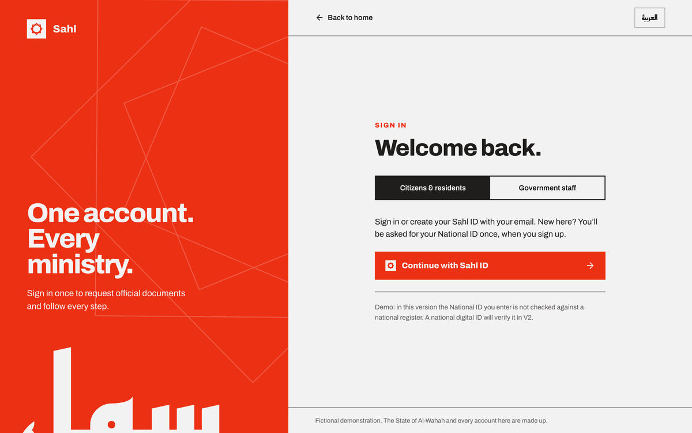
      <p><b>Two front doors.</b> Citizens use <i>Sahl ID</i> (Entra External ID). Ministry staff use their workforce account (Entra ID).</p>
    </td>
  </tr>
  <tr>
    <td width="50%" valign="top">
      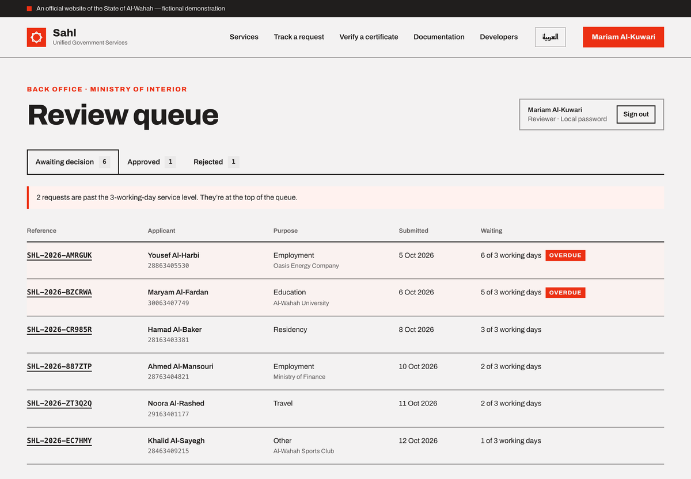
      <p><b>Review queue.</b> Requests past the 3-working-day service level are flagged and rise to the top. A reviewer sees only their own ministry.</p>
    </td>
    <td width="50%" valign="top">
      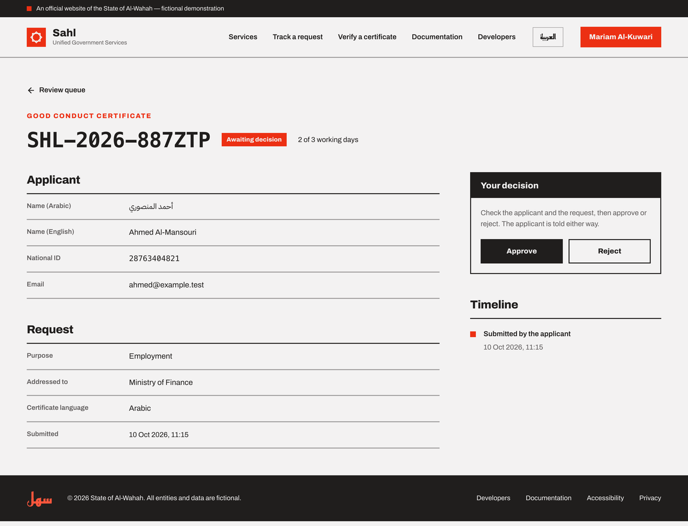
      <p><b>The decision.</b> Approve or reject, with a timeline of everything that happened. Approving issues the certificate.</p>
    </td>
  </tr>
  <tr>
    <td width="50%" valign="top">
      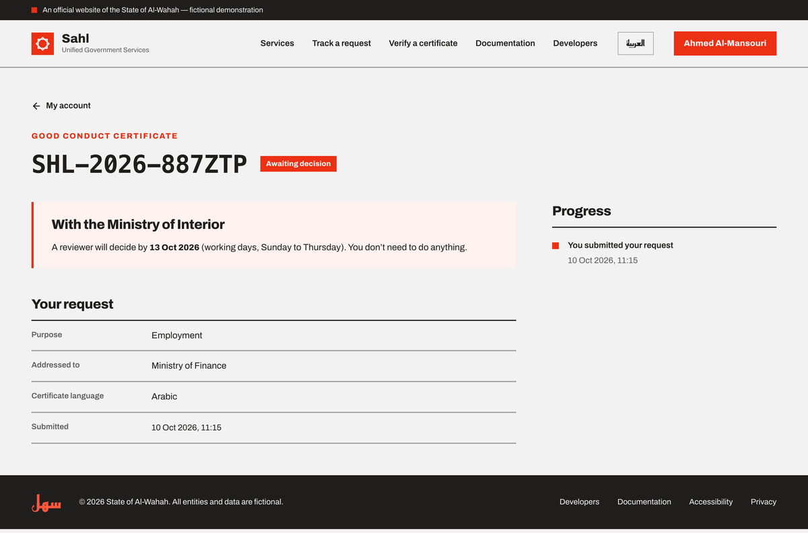
      <p><b>The citizen's side.</b> They follow every step and the expected decision date, without having to call anyone.</p>
    </td>
    <td width="50%" valign="top">
      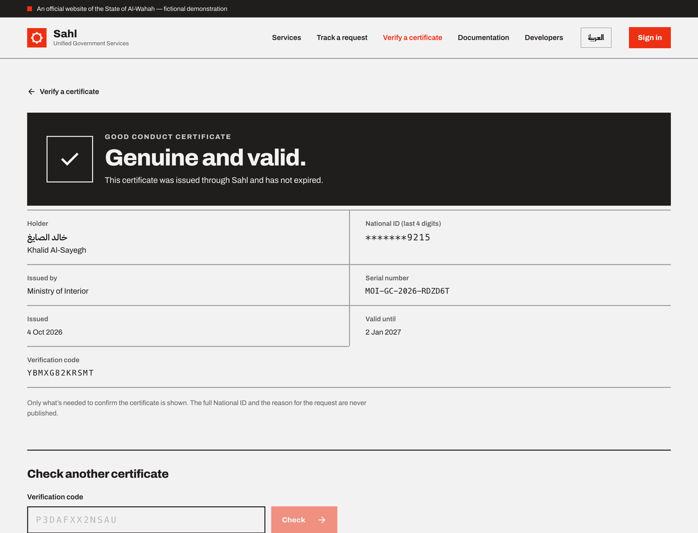
      <p><b>Anyone can verify.</b> Scan the QR code or type the code. Only what's needed to trust it is shown; the full National ID never is.</p>
    </td>
  </tr>
  <tr>
    <td width="50%" valign="top" align="center">
      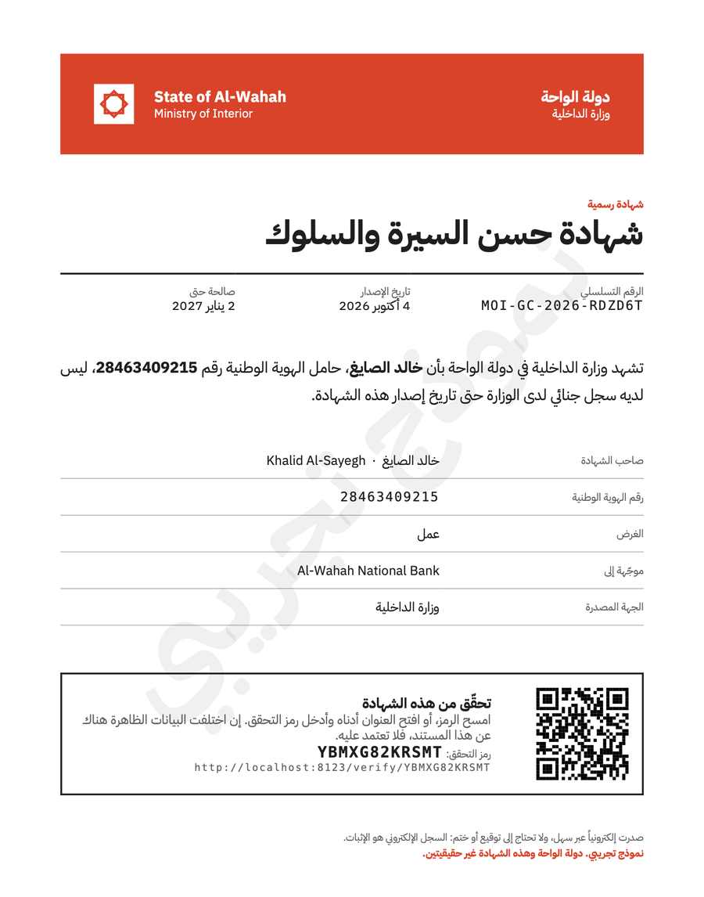
      <p align="left"><b>The certificate.</b> A bilingual PDF (mPDF, with proper Arabic shaping) generated from a snapshot taken when it was issued, with a QR code that opens <code>/verify/{code}</code>.</p>
    </td>
    <td width="50%" valign="top">
      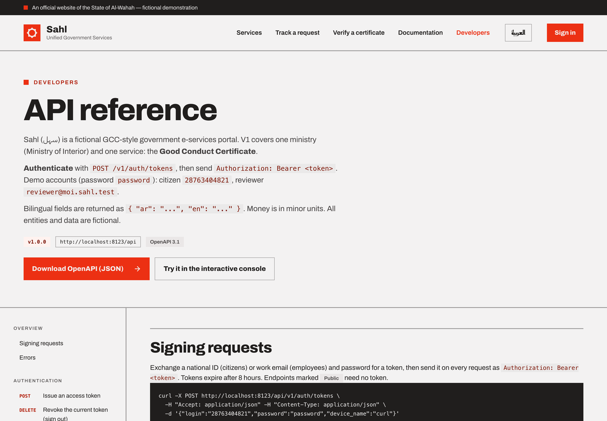
      <p><b>An API underneath.</b> The website and a versioned JSON API (<code>/api/v1</code>, Sanctum tokens) share the same actions and rules. The OpenAPI file is generated from the code.</p>
    </td>
  </tr>
</table>

<br>

## Architecture

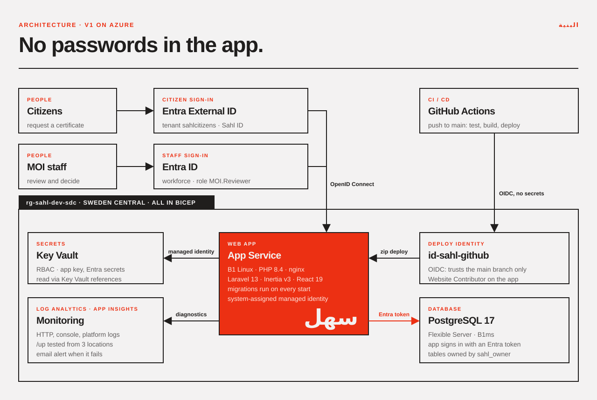

The whole environment is described in [`infra/main.bicep`](infra/main.bicep), and every manual step is written up so it can be rebuilt from scratch.

| | How |
|---|---|
| **No secrets in CI** | GitHub Actions signs in to Azure with **OIDC**. The `id-sahl-github` identity trusts only the `main` branch of this repo, and can only deploy to this one web app. |
| **No database password in the app** | The web app signs in to Postgres as **its own managed identity**. [`EntraPostgresConnector`](app/Database/EntraPostgresConnector.php) fetches a short-lived Entra token and uses it as the password. |
| **Least privilege in Postgres** | Tables belong to a group role, `sahl_owner`. The app, the admin and the owner's Entra account are members, so none of them needs server-admin rights to run migrations. |
| **Secrets in Key Vault** | The app key and the Entra client secrets are **Key Vault references**, read with the web app's managed identity. The vault uses Azure RBAC, not access policies. |
| **Deploys include migrations** | Each deploy restarts the app, and [`startup.sh`](infra/app-service/startup.sh) runs `migrate --force --isolated`. Code and schema go live together. |
| **Watched** | HTTP, console and platform logs go to Log Analytics. An availability test hits `/up` from 3 European locations and emails an alert if 2 of them fail. |
| **Privacy by default** | Other people's records return **404, not 403**. The public check shows only the last 4 digits of the National ID, and request reasons are never published. |

<br>

## Stack

| Layer | |
|---|---|
| **Backend** | Laravel 13 · PHP 8.4 · Pest (139 tests) · Sanctum · Socialite (Entra ID and a custom Entra External ID provider) · mPDF |
| **Frontend** | Inertia v3 · React 19 · TypeScript · Tailwind CSS v4 (design tokens in `@theme`) |
| **Data** | PostgreSQL 17 (Docker locally, Azure Flexible Server in the cloud) · UUIDv7 keys · money in minor units · certificate snapshots |
| **Identity** | Microsoft Entra External ID (citizens) · Microsoft Entra ID with app roles such as `MOI.Reviewer` (staff) |
| **Azure** | App Service (Linux B1) · Database for PostgreSQL · Key Vault · managed identities · Log Analytics · Application Insights · Bicep |
| **Delivery** | GitHub Actions: tests against a Postgres service container, then build, deploy and a smoke test |

<br>

## Run it locally

You need PHP 8.4, Composer, Node, and Docker (OrbStack works).

```bash
git clone https://github.com/abuel3ees/sahl.git && cd sahl
composer install && npm install
cp .env.example .env && php artisan key:generate

docker compose up -d                     # Postgres 17 (and an OpenTelemetry collector)
php artisan migrate:fresh --seed         # one ministry, one service, 8 demo requests

php artisan serve --port=8123            # then open http://localhost:8123
npm run dev                              # in a second terminal
```

> [!TIP]
> Use **`localhost`**, not `127.0.0.1`. Entra only redirects back to the registered address.
>
> Signing in on the website needs your own Entra app registrations (`ENTRA_*` and `ENTRA_CITIZEN_*` in `.env`); see [setup 01](docs/setup/01-entra-id-staff-sign-in.md) and [02](docs/setup/02-entra-external-id-citizen-sign-in.md). The **API** works without them. The demo accounts all use the password `password`: citizen `28763404821`, reviewer `reviewer@moi.sahl.test`.

**Checks:** `php artisan test --compact` · `npm run typecheck` · `vendor/bin/pint --dirty`

<br>

## Built in public

The project keeps two kinds of written record:
- **The [work journal](docs/journal/README.md):** one dated entry per unit of work, covering what was asked, what was done and which decisions were made.
- **The setup guides:** every manual Azure and Entra step, with the exact values used (never secrets) and a checklist for redoing it.

| | Setup guide |
|---|---|
| 01 | [Entra ID: staff sign-in](docs/setup/01-entra-id-staff-sign-in.md) |
| 02 | [Entra External ID: citizen sign-in](docs/setup/02-entra-external-id-citizen-sign-in.md) |
| 03 | [Postgres in Docker, locally](docs/setup/03-docker-postgres-local.md) |
| 04 | [Azure Database for PostgreSQL](docs/setup/04-azure-postgres.md) |
| 05 | [App Service: Sahl live on Azure](docs/setup/05-azure-app-service.md) |
| 06 | [Key Vault, managed identity and sign-in on Azure](docs/setup/06-key-vault-sign-in.md) |
| 07 | [Deploy from GitHub Actions (OIDC)](docs/setup/07-github-actions-deploy.md) |
| 08 | [Postgres sign-in with the managed identity](docs/setup/08-postgres-entra-sign-in.md) |
| 09 | [Monitoring and alerts](docs/setup/09-monitoring.md) |

Study notes live in [`docs/learning/`](docs/learning/), and the full future data model is in [`docs/architecture/erd.md`](docs/architecture/erd.md).

<br>

## Roadmap

- [x] **V1:** Ministry of Interior · Good Conduct Certificate, end to end
- [x] V1 on Azure: App Service, Postgres, Key Vault, OIDC deploys, password-free app identity, monitoring
- [ ] **In progress:** OpenTelemetry traces (an App Service sidecar sending to Application Insights)
- [ ] Turn off password sign-in on Postgres entirely
- [ ] **V2:** a mock *Al-Wahah National Digital ID* federated into Entra External ID, so the National ID is verified instead of self-declared
- [ ] Later: more ministries, payments, signing certificates with Key Vault, immutable Blob storage, API Management, Front Door, Service Bus

<br>

<div align="center">

**سهل** &nbsp;/sahl/ &nbsp;*adj.* easy, effortless; *n.* open, level ground.

<sub>Fonts: <a href="https://fonts.google.com/specimen/Archivo">Archivo</a>, <a href="https://github.com/IBM/plex">IBM Plex Sans Arabic</a> and <a href="https://fonts.google.com/specimen/Reem+Kufi">Reem Kufi</a>, all under the SIL Open Font License.<br>
The State of Al-Wahah and every entity, person and document in this repository are fictional.</sub>

</div>
