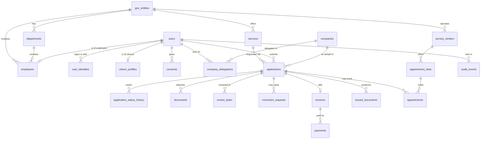
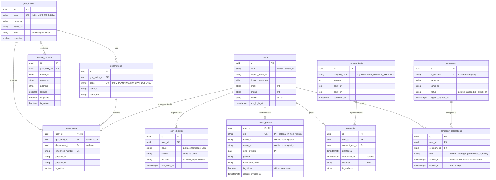
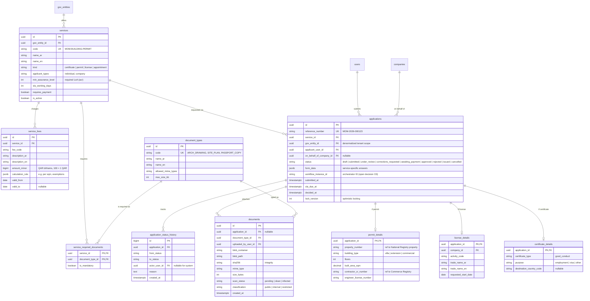
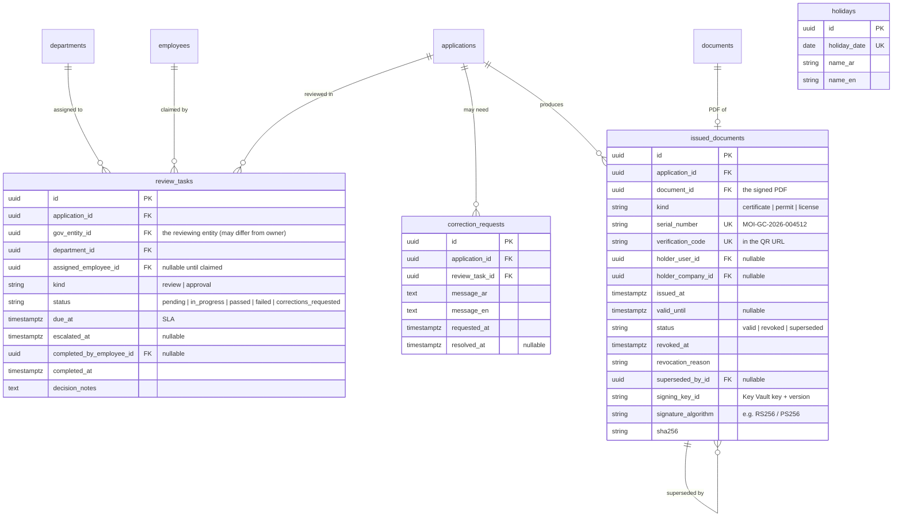
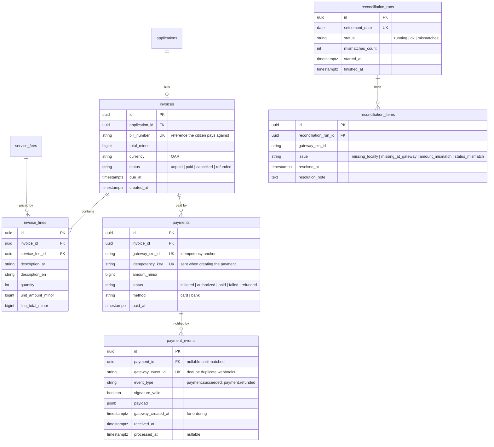
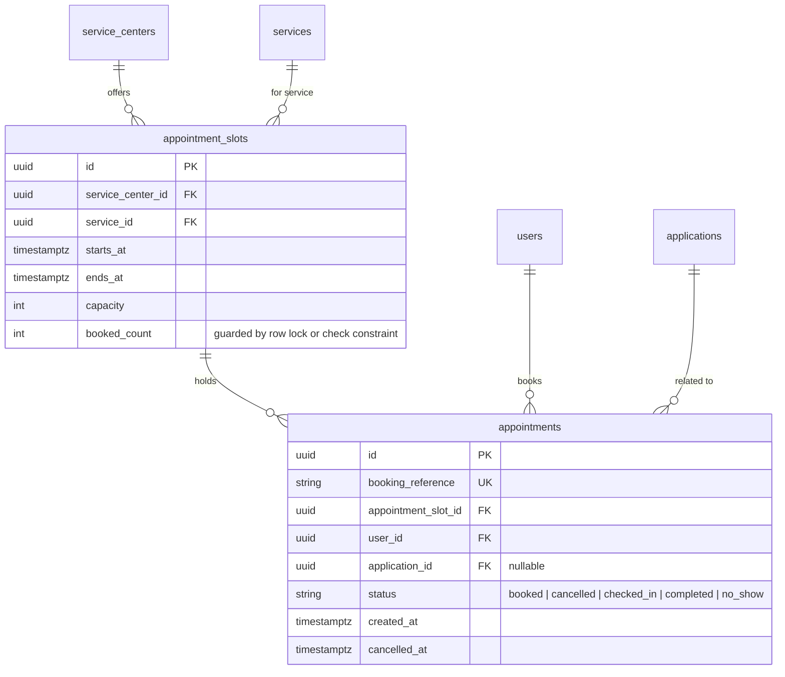
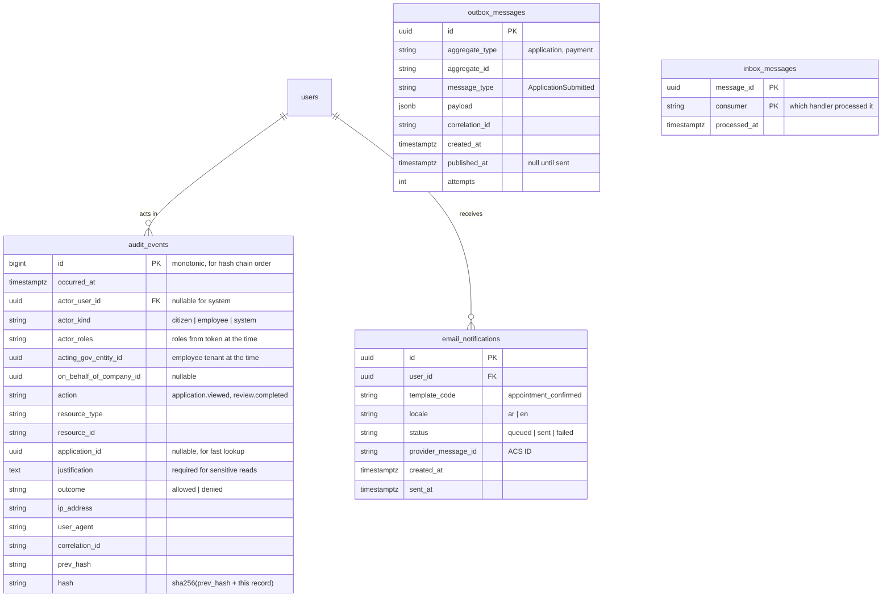
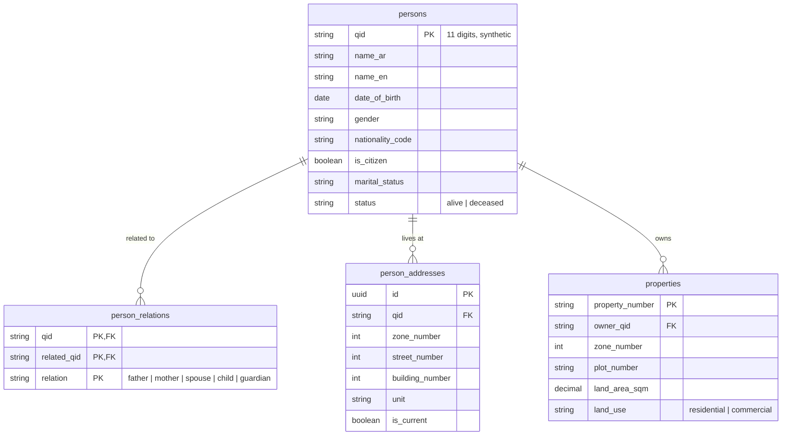
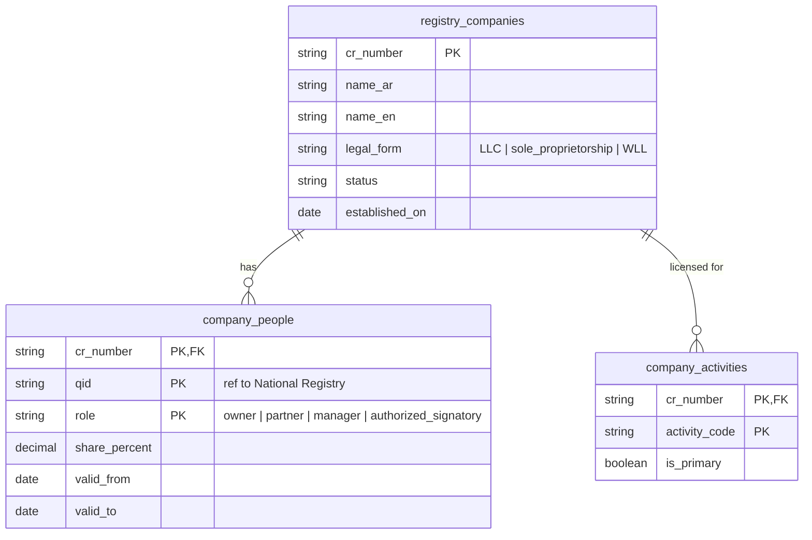
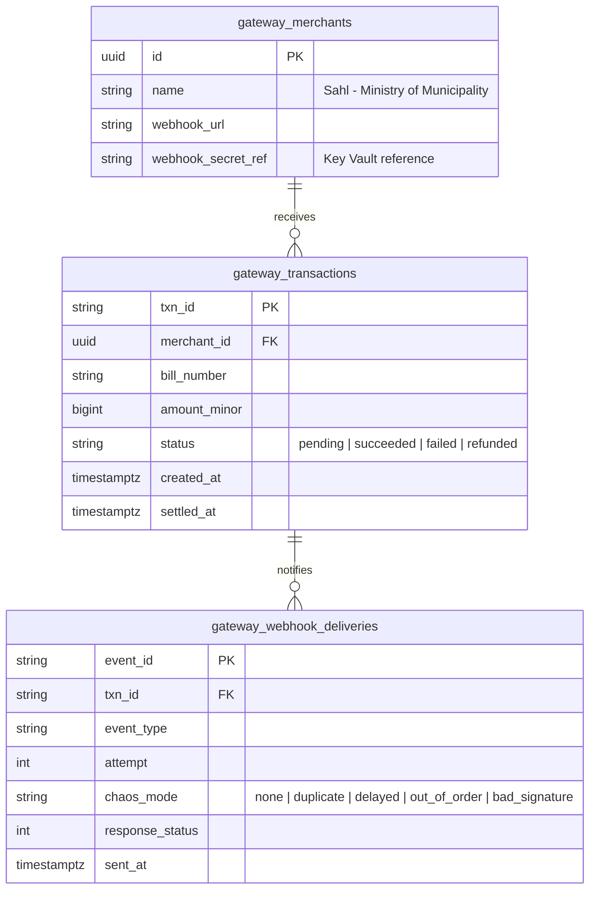

# Sahl — Entity Relationship Diagrams (ERD)

> Status: **Draft v0.1** — for review. Decisions marked **❓** need your confirmation before we write migrations.
> Diagrams are [Mermaid](https://mermaid.js.org/syntax/entityRelationshipDiagram.html) — they render on GitHub and in VS Code (with a Mermaid extension).

---

## How to read an ERD

An ERD shows **tables (entities)**, their **columns (attributes)**, and how they **relate**.

**Cardinality symbols (crow's foot notation):**

| Symbol | Meaning | Laravel equivalent |
|---|---|---|
| `\|\|--o{` | one to **zero or more** | `hasMany` / `belongsTo` |
| `\|\|--\|{` | one to **one or more** | `hasMany` (at least one required by business rule) |
| `\|\|--o\|` | one to **zero or one** | `hasOne` (optional) |
| `\|\|--\|\|` | exactly one to exactly one | `hasOne` (required) |
| `}o--o{` | many to many | `belongsToMany` (pivot table) |

**Keys:** `PK` primary key · `FK` foreign key · `UK` unique.

---

## The big picture: which database owns what

The first architecture lesson in a data model is **ownership**. In a real government, Sahl does **not** own citizen identity data or company data — the national registries do. So they are **separate systems with separate databases**, and Sahl only stores **references** (QID, CR number) and **cached copies**.

```
┌─────────────────────────── Sahl platform DB (PostgreSQL) ───────────────────────────┐
│  Organization & people · Service catalog · Applications & workflow · Issued docs   │
│  Payments · Appointments · Consent · Audit · Outbox/Inbox                           │
└─────────────────────────────────────────────────────────────────────────────────────┘
        ▲ API calls via APIM (no shared DB, no cross-DB foreign keys)
        │
┌───────┴────────────┬──────────────────────┬────────────────────────┬──────────────────────┐
│ National Registry  │ Commerce Registry    │ Mock National IdP      │ Mock Payment Gateway │
│ (persons,          │ (companies,          │ (login accounts,       │ (transactions,       │
│  relations,        │  signatories)        │  OIDC clients)         │  webhooks)           │
│  addresses,        │  owned by Ministry   │  owned by national     │  owned by national   │
│  properties)       │  of Commerce         │  identity authority    │  payment platform    │
└────────────────────┴──────────────────────┴────────────────────────┴──────────────────────┘
```

**Rule:** a foreign key may **never** cross a database boundary. Across boundaries we store the **natural identifier** (`qid`, `cr_number`, `property_number`, `gateway_txn_id`) and call the owning system's API when we need fresh data.

---

## 1. Overview (relationships only)



---

## 2. Organization, people and identity



**Why it looks like this**

- **`users` + `user_identities` (not one table).** A person's *login* (issuer + subject from Entra) is separate from the *person*. Unique key is `(issuer, subject)` — never the email. This is how you safely support two Entra tenants, and later account linking.
- **`citizen_profiles` and `employees` as 1:1 extensions of `users`.** Shared columns live in `users`; population-specific columns live in their own table. (Pattern name: **class table inheritance**.)
- **No roles table for employees.** Roles (`Reviewer`, `Approver`…) come from **Entra app roles in the token** at login. Storing them here would create a second source of truth that drifts when someone is removed in Entra. The *roles used* are captured in each audit event instead.
- **`gov_entity_id` on employees** is the **tenant scope** for everything they can see.
- **`company_delegations` is a cache**, not the source of truth. The Commerce Registry decides; we store the last answer with an expiry and re-check (Chapter 8).
- **Bilingual columns** (`name_ar`, `name_en`) instead of a translations table — Arabic and English are fixed and both always required. ❓ (see decisions)

---

## 3. Service catalog and applications



**Why it looks like this**

- **One `applications` table for all services** — the *common lifecycle* (submitted → reviewed → paid → issued) is identical across ministries. This is what makes it a **platform**: a new service is mostly configuration in `services`, not new tables.
- **Service-specific data: two layers.**
  - Things we **query, filter, report or validate strongly** (permit floors, area, property) → typed **extension tables** (`permit_details`…).
  - Long-tail form answers → **`form_data` JSONB**.
  - Trade-off: JSONB is flexible but weakly validated and hard to report on; extension tables are strict but need migrations. ❓
- **`gov_entity_id` is copied onto `applications`** even though it's reachable via `services`. That's **intentional denormalization**: every tenant-scoped query and Postgres **Row-Level Security** policy can filter on one column without a join.
- **`reference_number`** — citizens and employees never see UUIDs; they see `MOM-2026-000123`. Separate from the PK.
- **`application_status_history`** — an append-only record of every transition (the state machine's memory). The `status` column is just the latest value.
- **`lock_version`** — **optimistic locking**: two reviewers editing the same application at once → the second save fails instead of silently overwriting.
- **Money as integers (`amount_minor`)** — never floats. 150.50 QAR = `15050`.
- **Documents: metadata in DB, bytes in Blob Storage**, with a SHA-256 hash so we can prove a file wasn't changed. `scan_status` because uploaded files must be malware-scanned before employees open them (Defender for Storage malware scanning, or a scanning function).

---

## 4. Reviews, workflow and issued documents



**Why it looks like this**

- **`review_tasks` carries its own `gov_entity_id`** — Civil Defense (Interior) reviews a Municipality permit. The task belongs to the **reviewing** entity; the application belongs to the **owning** entity. That's how cross-entity collaboration works **without** giving Interior access to all Municipality data (Chapter 9).
- **Separation of duties** is enforced in Laravel policies using this table: an employee who completed a `review` task on an application can't complete its `approval` task.
- **Orchestration state is *not* here.** Timers, fan-out/fan-in and waiting live in the workflow engine (open decision O3); this table is the **business-visible** state that employees and auditors see. If we choose an in-app state machine instead, this table becomes the engine's state too.
- **`holidays`** + a configured weekend → the **working-day calendar** for SLA due dates.
- **`issued_documents` is separate from `documents`** — an uploaded drawing and an issued, signed, revocable government certificate are very different things legally. Verification (QR page) reads only this table and shows minimal data.
- **Revocation & superseding** — a corrected certificate *supersedes* the old one; the old one remains (history is never deleted) but shows "superseded" when scanned.

---

## 5. Payments



**Why it looks like this**

- **Invoice ≠ payment.** An invoice is *what is owed*; payments are *attempts to pay it* (a citizen may fail twice, then succeed). One invoice → many payments.
- **Two unique keys make it idempotent:** `payments.gateway_txn_id` (same transaction can't be recorded twice) and `payment_events.gateway_event_id` (same webhook processed once). The database enforces idempotency even if application code has a bug — **let the database be the last line of defense**.
- **`payment_events` stores every webhook raw**, valid or not, *before* processing — so you can replay, debug, and prove what the gateway told you.
- **`gateway_created_at`** handles out-of-order events: a "succeeded" older than the current state doesn't overwrite a later "refunded."
- **Reconciliation tables** record each nightly comparison and every mismatch until someone resolves it.

---

## 6. Appointments



**Why it looks like this**

- **The classic concurrency problem:** two citizens book the last seat at the same millisecond. Solutions: `SELECT … FOR UPDATE` on the slot row inside a transaction, or an atomic `UPDATE … SET booked_count = booked_count + 1 WHERE booked_count < capacity` and check affected rows, plus a `CHECK (booked_count <= capacity)` constraint as the safety net.
- Unique `(appointment_slot_id, user_id)` for active bookings stops double-booking the same slot.
- Timestamps are `timestamptz` and stored in **UTC**; displayed in Qatar time (UTC+3, no daylight saving).

---

## 7. Audit, messaging and notifications



**Why it looks like this**

- **`audit_events` is append-only**: the app's DB role gets `INSERT` and `SELECT` only — no `UPDATE`/`DELETE` (enforced with Postgres grants). Each row is also shipped to **immutable Blob Storage** (Chapter 17). The **hash chain** (`prev_hash` → `hash`) makes any tampering with the DB copy detectable.
- **Audit columns are copied values, not foreign keys** where history matters (`actor_roles`, `acting_gov_entity_id`): the audit must show the truth **at that moment**, even if the employee later moves ministry.
- **`outbox_messages`** — written in the **same transaction** as the business change; a relay publishes to Service Bus/Event Grid and sets `published_at` (Chapter 11).
- **`inbox_messages`** — consumers record what they processed; composite PK `(message_id, consumer)` makes re-delivery harmless.

---

## 8. External systems (separate databases)

These belong to **other (fictional) government organizations**. They live in separate services, with their own databases, and Sahl reaches them only through APIs via APIM.


*National Registry (mock) — owned by the fictional Ministry of Interior's registry.*


*Commerce Registry (mock) — owned by the fictional Ministry of Commerce.*


*Mock Payment Gateway — owned by the fictional national payment platform.*

The **Mock National IdP** mostly holds login credentials keyed by `qid` plus OIDC client configuration; its schema is defined by whichever IdP implementation we pick (open decision O7), so it's not modeled here.

---

## Cross-cutting conventions

| Convention | Choice | Why |
|---|---|---|
| Primary keys | **UUIDv7** (Laravel `HasUuids` default in recent versions ⚠ Verify) | Not guessable in URLs (no `/applications/1, /2, /3` enumeration of citizens' records), safe to generate in any service, and v7 is time-ordered so indexes stay efficient. `bigint` only for append-heavy internal logs |
| Timestamps | `timestamptz`, stored UTC | One truth; display in Asia/Qatar |
| Money | `bigint` minor units + currency | No floating-point rounding |
| Bilingual text | `_ar` / `_en` columns | Both languages mandatory and fixed |
| Soft deletes | **Not used** for business records; use explicit statuses (`cancelled`, `revoked`) | Government records are rarely "deleted"; statuses + history are clearer and auditable |
| Tenant scope | `gov_entity_id` on every entity-owned table | Global scopes + optional Postgres RLS |
| PII marking | Column comments / a data dictionary with classification | Drives masking in logs, export rules, encryption choices |
| External references | Natural IDs (`qid`, `cr_number`, `property_number`), no cross-DB FKs | Respects data ownership |
| Status columns | Strings validated by PHP enums (+ `CHECK` constraints) | Readable in SQL and audit; enum class is the state machine's vocabulary |

---

## ❓ Decisions to confirm before migrations

| # | Question | My recommendation | Alternative |
|---|---|---|---|
| E1 | Where does **Civil Defense** sit? | **Department of Ministry of Interior** — makes permit reviews genuinely **cross-entity** (realistic, and the best authorization lesson) | Department of Municipality (simpler, no cross-entity) |
| E2 | Where does **Electricity** review sit? | Department of Municipality for v1 (we capped at 3 ministries); note that in reality it's a utility authority | Add a 4th entity (utility authority) |
| E3 | Service-specific data | **Extension tables for core fields + JSONB for the long tail** | All JSONB (fastest to build) · all typed tables (strictest) |
| E4 | Primary keys | **UUIDv7** everywhere except append-only logs | bigint auto-increment |
| E5 | Bilingual storage | **`_ar` / `_en` columns** | Translations table / JSON column per field |
| E6 | Postgres Row-Level Security | **Add in a later step** as a second wall behind Laravel scopes | Laravel scopes only |
| E7 | Audit storage | **DB (searchable) + immutable Blob (legal copy)** | Blob only |
| E8 | Workflow state | Depends on **O3** (Durable Functions / Logic Apps / in-app). This ERD works for all three | — |

---

## Self-test

1. Why is there no foreign key from `citizen_profiles.qid` to the registry's `persons.qid`?
2. Why does `review_tasks` have its own `gov_entity_id` when `applications` already has one?
3. Which two unique constraints make payment processing idempotent?
4. Why are employee roles **not** stored in a table?
5. What's the risk if `audit_events` stored `actor_user_id` but not `actor_roles`?
6. Why are UUIDs safer than auto-increment IDs in citizen-facing URLs?
7. How does the appointment schema prevent overbooking the last seat?
