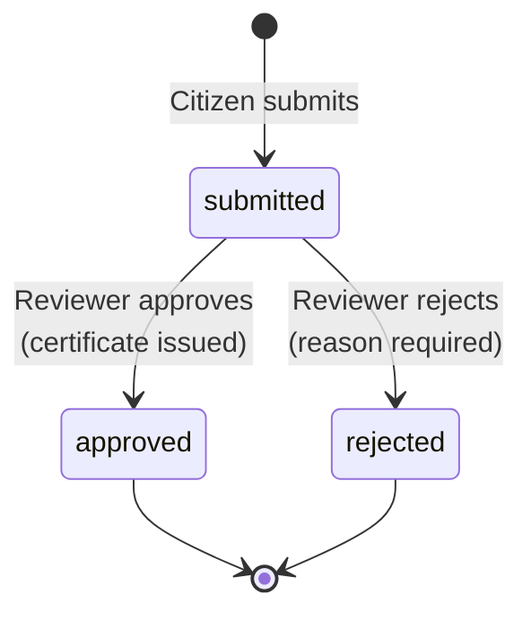
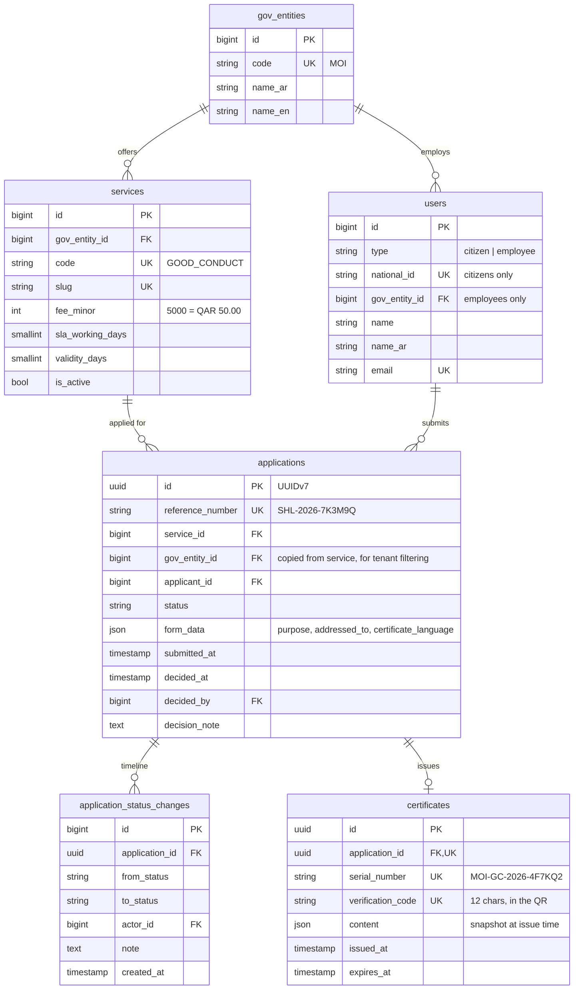

# Ministry of Interior: Good Conduct Certificate (V1)

> **Sahl V1** has one ministry and one service, built end to end.
> Everything here is fictional.

| | |
|---|---|
| **Ministry** | Ministry of Interior · وزارة الداخلية (code `MOI`) |
| **Service** | Good Conduct Certificate · شهادة حسن السيرة والسلوك (code `GOOD_CONDUCT`) |
| **Who applies** | Citizens (signed in with their national ID) |
| **Who decides** | Ministry of Interior reviewers (back office) |
| **Fee** | QAR 50.00 (`5000` minor units), displayed only. Payment is not part of V1 |
| **Service level** | 3 working days |
| **Certificate validity** | 90 days from issue |
| **API reference** | [`docs/api/openapi.json`](../api/openapi.json) · on the site at `/developers` |
| **Website** | `/` landing page · `/developers` API reference · `/docs/ministry-of-interior` this page |

---

## 1. The story in 30 seconds

1. **Ahmed** (citizen) signs in and applies for a good-conduct certificate "for employment".
2. **Mariam** (MOI reviewer) sees it in her queue, checks it, and **approves** it.
3. Approving **issues a certificate** with a serial number and a 12-character verification code.
4. Ahmed gives the certificate to his employer. The employer scans the QR code, which opens the **public verification** endpoint, and sees "valid" with Ahmed's name and a masked ID.

---

## 2. Application lifecycle



| Rule | Why |
|---|---|
| A decision is final. Deciding twice returns **409 Conflict** | Prevents two reviewers double-approving at the same moment. The row is locked (`SELECT … FOR UPDATE`) while deciding |
| One **open** (`submitted`) application per citizen per service | Stops duplicate requests. After a decision, the citizen can apply again |
| Every transition writes a row to `application_status_changes` | An append-only timeline, the start of a proper audit trail |
| Approval and certificate issuing happen in **one transaction** | There's never an "approved" application without a certificate, or the other way round |
| A rejection needs a reason (≥ 10 characters) | The citizen is entitled to know why |

---

## 3. Who can do what

| Action | Citizen (owner) | Other citizen | MOI reviewer | Reviewer of another ministry |
|---|---|---|---|---|
| Browse services, verify a certificate | ✅ (public) | ✅ (public) | ✅ (public) | ✅ (public) |
| Submit an application | ✅ | ✅ (their own) | ❌ 403 | ❌ 403 |
| See an application | ✅ | ❌ **404** | ✅ | ❌ **404** |
| See the certificate | ✅ once approved | ❌ 404 | ✅ via back office | ❌ 404 |
| Approve / reject | ❌ 403 | ❌ 403 | ✅ (never their own application) | ❌ **404** |

**Why 404 and not 403?** A 403 means "this exists, but you can't have it", which leaks that the record exists. For someone else's government records, the answer is "not found". This rule lives in `app/Policies/ApplicationPolicy.php`.

**Tenant scoping:** each employee belongs to one ministry (`users.gov_entity_id`). Back-office queries always filter by it. This is the "pool multi-tenancy" model from the architecture guide, already in place even though V1 has only one ministry.

---

## 4. Data model (V1 tables only)



Design notes:

- **`certificates.content` is a snapshot.** If Ahmed changes his name next year, the certificate he was issued still shows what was true on the day it was issued, exactly like a paper certificate.
- **Codes avoid look-alike characters** (no `0/O`, `1/I/L`) because people read them aloud over the phone.
- **Application IDs are UUIDv7**: not guessable, but still time-ordered for good index performance (ERD decision E4).

---

## 5. Application form fields

| Field | Required | Values |
|---|---|---|
| `service` | ✅ | `good-conduct-certificate` |
| `purpose` | ✅ | `employment`, `travel`, `residency`, `education`, `other` |
| `addressed_to` | — | Free text, max 150. Empty = "To whom it may concern" |
| `certificate_language` | ✅ | `ar` or `en` |

---

## 6. API walkthrough (copy and paste)

Start the app: `php artisan migrate:fresh --seed`, then `composer run dev` (or `npm run dev` plus `php artisan serve --port=8123`).

Demo accounts (password `password`):

| Who | Login |
|---|---|
| Citizen: Ahmed Al-Mansouri | `28763404821` |
| Citizen: Noora Al-Rashed | `29163401177` |
| MOI reviewer: Mariam Al-Kuwari | `reviewer@moi.sahl.test` |

```bash
API=http://localhost:8123/api/v1
J=(-H 'Accept: application/json' -H 'Content-Type: application/json')

# 1. Public catalog
curl -s $API/services "${J[@]}"

# 2. Citizen signs in → token
CITIZEN=$(curl -s -X POST $API/auth/tokens "${J[@]}" \
  -d '{"login":"28763404821","password":"password","device_name":"curl"}' | jq -r .token)

# 3. Citizen applies → 201
APP_ID=$(curl -s -X POST $API/applications "${J[@]}" -H "Authorization: Bearer $CITIZEN" \
  -d '{"service":"good-conduct-certificate","purpose":"employment","certificate_language":"ar"}' | jq -r .data.id)

# 4. Reviewer signs in and sees the queue
REVIEWER=$(curl -s -X POST $API/auth/tokens "${J[@]}" \
  -d '{"login":"reviewer@moi.sahl.test","password":"password","device_name":"curl"}' | jq -r .token)
curl -s "$API/backoffice/applications?status=submitted" "${J[@]}" -H "Authorization: Bearer $REVIEWER"

# 5. Reviewer approves → certificate issued
curl -s -X POST $API/backoffice/applications/$APP_ID/approval "${J[@]}" \
  -H "Authorization: Bearer $REVIEWER" -d '{"note":"Record is clear."}'

# 6. Citizen fetches the certificate
CODE=$(curl -s $API/applications/$APP_ID/certificate "${J[@]}" -H "Authorization: Bearer $CITIZEN" | jq -r .data.verification_code)

# 7. Anyone verifies it (no login)
curl -s $API/certificates/verify/$CODE "${J[@]}"
```

### Endpoint summary

| Method | Path | Who | Purpose |
|---|---|---|---|
| `POST` | `/auth/tokens` | public | Sign in with national ID or email, returns a Bearer token (8-hour expiry) |
| `DELETE` | `/auth/tokens/current` | signed in | Sign out |
| `GET` | `/me` | signed in | Current user |
| `GET` | `/services` · `/services/{slug}` | public | Service catalog |
| `GET` | `/applications` | citizen | My applications (newest first, 20 per page) |
| `POST` | `/applications` | citizen | Submit |
| `GET` | `/applications/{id}` | owner | Details and timeline and certificate |
| `GET` | `/applications/{id}/certificate` | owner | Certificate (404 until approved) |
| `GET` | `/certificates/verify/{code}` | public | Verification for apps (30 checks per minute per IP). People scanning the QR land on the web page `/verify/{code}` instead |
| `GET` | `/backoffice/applications?status=` | MOI reviewer | Review queue (oldest first) |
| `GET` | `/backoffice/applications/{id}` | MOI reviewer | Details including applicant |
| `POST` | `/backoffice/applications/{id}/approval` | MOI reviewer | Approve and issue certificate |
| `POST` | `/backoffice/applications/{id}/rejection` | MOI reviewer | Reject with reason |

### Errors

| Status | Meaning in Sahl |
|---|---|
| `401` | No token or an expired token |
| `403` | You're signed in, but your role can't do this (e.g. a citizen calling the back office) |
| `404` | Doesn't exist, **or** it isn't yours (see §3) |
| `409` | The application was already decided |
| `422` | Validation failed. See `errors.{field}` |
| `429` | Too many attempts (sign-in: 5 per minute; verify: 30 per minute) |

All errors are JSON: `{ "message": "...", "errors": { ... } }`.

---

## 7. Privacy and security choices

| Choice | Where |
|---|---|
| Public verification shows only the **last 4 digits** of the national ID | `CertificateVerificationResource` |
| The citizen's timeline shows "ministry", **never the reviewer's name** | `ApplicationStatusChangeResource` |
| Tokens expire after 8 hours (`SANCTUM_TOKEN_EXPIRATION`) | `config/sanctum.php` |
| Sign-in is rate-limited per login and IP | `AppServiceProvider` |
| A reviewer can't decide their own application | `ApplicationPolicy::decide` |

---

## 8. The website

The public pages follow the **"Poster" direction** of the Sahl design: a full red hero with a giant Kufic **سهل** wordmark, a photo strip, a service ticker, and the featured service next to a live request-status demo.

| Page | URL | Built from |
|---|---|---|
| Landing | `/` | `resources/js/pages/landing.tsx`. The featured-service facts (ministry, processing time, fee) come from the `services` table |
| API reference | `/developers` | `resources/js/pages/developers/api-reference.tsx`. Rendered from `docs/api/openapi.json` |
| This document | `/docs/ministry-of-interior` | `resources/js/pages/docs/show.tsx`. This Markdown file, rendered on the server. Diagrams are drawn by Mermaid in the browser |
| Verify a certificate (public) | `/verify`, `/verify/{code}` | `resources/js/pages/verify/`. No sign-in. Valid / expired / not found, with the same masked data as the API and the same 30-a-minute limit. **This is what the QR code opens** (`verification_url`) |
| Sign in | `/login` | `resources/js/pages/auth/login.tsx`. Citizens continue to **Sahl ID** (Entra External ID), staff to **Microsoft Entra ID** |
| Request a certificate (citizen) | `/services/good-conduct-certificate/apply` | `resources/js/pages/citizen/apply.tsx`. Two steps (fill in, then review), purpose cards, optional addressee, certificate language, declaration. Same rules as `POST /api/v1/applications`, plus the declaration |
| My account and my request (citizen) | `/account`, `/account/applications/{id}` | `resources/js/pages/citizen/`. Status, "decision due by" date (working days), progress timeline, rejection reason, and the verification code once approved |
| Review queue (back office) | `/staff` | `resources/js/pages/staff/applications/index.tsx`. The reviewer's ministry only, waiting requests oldest first, with the SLA clock |
| Request (back office) | `/staff/applications/{id}` | `resources/js/pages/staff/applications/show.tsx`. Applicant, request, timeline, certificate, and the approve/reject panel |

**Back office for reviewers:**

- **Sign-in:** reviewers sign in with Entra ID. The app role `MOI.Reviewer` in their token decides which ministry they review for. How it was set up: `docs/setup/01-entra-id-staff-sign-in.md`.
- **Same rules as the API:** the website calls the same actions (`ApproveApplication`, `RejectApplication`), form requests and `ApplicationPolicy`. Another ministry's request is a 404.
- **Two-step decision:** write the note or reason, then confirm. Approving issues the certificate at once. A rejection needs a reason of at least 10 characters, which the applicant sees.
- **Two reviewers at once:** if a colleague decided first, the second click changes nothing. The page says so (the API returns 409).
- **SLA:** working days exclude Friday and Saturday. A request waiting longer than the service's `sla_working_days` (3) is flagged **Overdue** and sits at the top of the queue.

**Design system ("Modernist"):** Archivo for Latin text, IBM Plex Sans Arabic for Arabic body text, Reem Kufi for Arabic headings. One red accent (`#ec3013`), 2px rules, zero border radius. All the tokens live in `@theme` in `resources/css/app.css`, so Tailwind classes like `bg-accent`, `text-ink` and `border-divider` come from the design.

**Fonts are self-hosted.** Vite downloads them at build time (`vite.config.js`), so visitors' browsers never call Google. That's one less third party seeing citizens' traffic, which is a typical government privacy requirement.

**Arabic and English:**

| How | Where |
|---|---|
| Arabic is the default (`APP_LOCALE=ar`), rendered right-to-left | `resources/views/app.blade.php` sets `<html lang dir>` on the server, so there's no flash of the wrong direction |
| The toggle saves a `lang` cookie; a `?lang=en` link also works | `app/Http/Middleware/SetLocale.php`, `resources/js/lib/i18n.tsx` |
| UI strings are `{ en, ar }` pairs, the same shape the API uses | `t({ en: 'Sign in', ar: 'تسجيل الدخول' })` |
| Layout uses logical properties (`ms-`, `pe-`, `start-`, `border-s`), so it mirrors automatically | Arrows flip with `rtl:-scale-x-100` |
| Technical docs stay English (left-to-right) inside the Arabic layout, with a notice | `resources/js/layouts/docs-layout.tsx` |

**Motion** (hero reveal, turning star, marquees, status demo) is switched off for visitors whose system asks for reduced motion (`motion-safe:` classes and `usePrefersReducedMotion`).

**Photos:** the strip ships with hatched placeholders. Drop black-and-white photos into `public/images/marquee/` and set `src` in `PHOTOS` in `landing.tsx`.

---

## 9. Where the code lives

```
app/
├── Actions/Applications/        SubmitApplication, ApproveApplication, RejectApplication
├── Enums/                       ApplicationStatus, CertificatePurpose, CertificateLanguage, UserType
├── Http/Controllers/Api/V1/     thin controllers (validate → authorize → action → resource)
├── Http/Requests/Api/V1/        validation rules
├── Http/Resources/Api/V1/       JSON shapes
├── Models/                      GovEntity, Service, Application, ApplicationStatusChange, Certificate, User
└── Policies/ApplicationPolicy   who can see/decide what
routes/api.php                   all /api/v1 routes
resources/js/                    the website (Inertia + React + TypeScript)
tests/Feature/                   60 tests, run with: php artisan test --compact
```

The **Actions** are the important part. The Inertia/React screens built next will call the *same* actions, so the API and the website can never disagree about the rules.

### Regenerating the Swagger / OpenAPI file

The spec is generated from the code by [Scramble](https://scramble.dedoc.co), so it can't drift out of date:

```bash
php artisan scramble:export      # writes docs/api/openapi.json
# the site's /developers page reads this file, so it updates too
# http://localhost:8123/docs/api is Scramble's interactive "try it" console (local only)
```

---

## 10. Not in V1 (on purpose)

| Later | Notes |
|---|---|
| PDF certificate with QR image | Next step. The verification code and URL already exist |
| Web sign-in, "Start request", "Track a request" and "Verify" pages | The buttons are in place; the screens come after the PDF. The API behind them already works |
| Sign-in with Entra ID | The token sign-in here is a local stand-in |
| Payment of the QAR 50 fee | The fee is stored and displayed only |
| Document uploads, corrections, "request more info" | Needs Blob Storage |
| Email notifications | Azure Communication Services |
| More ministries and services | The schema already supports them (`gov_entity_id` everywhere) |
| PostgreSQL | V1 runs on SQLite locally. The code is portable |
